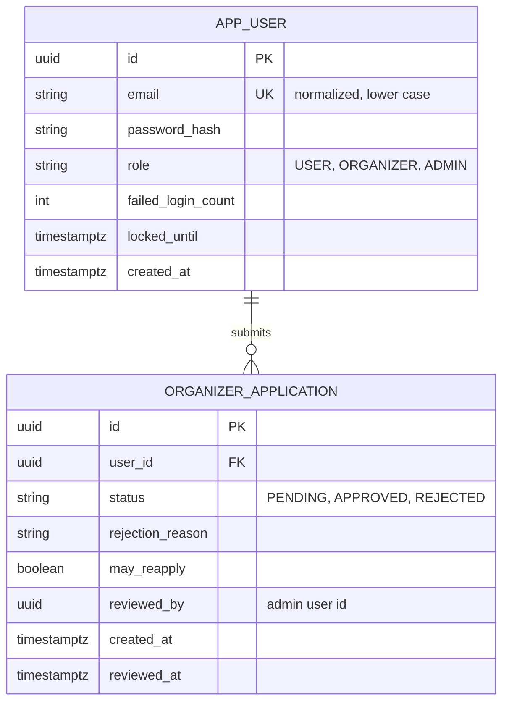
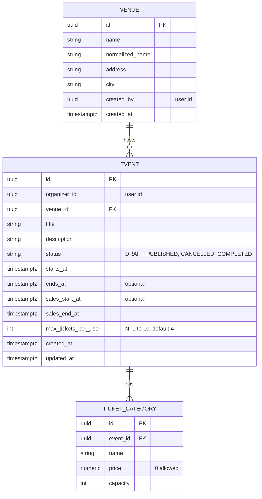
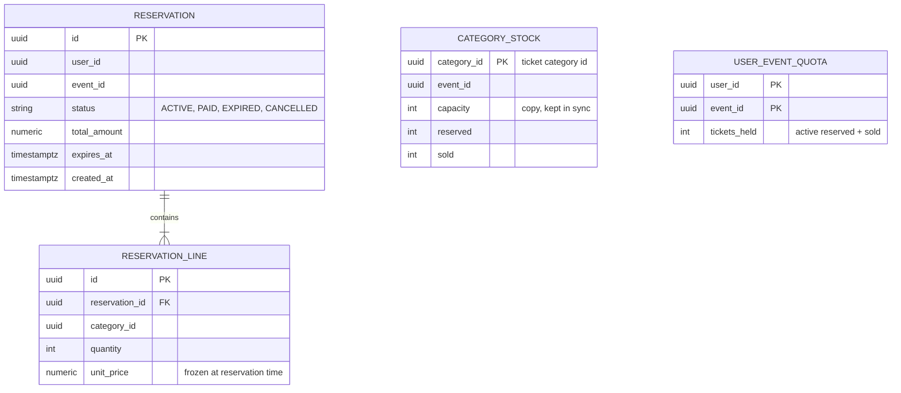
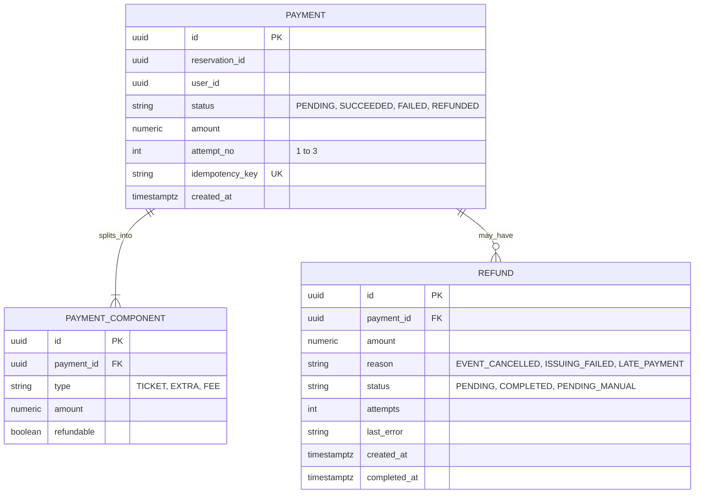
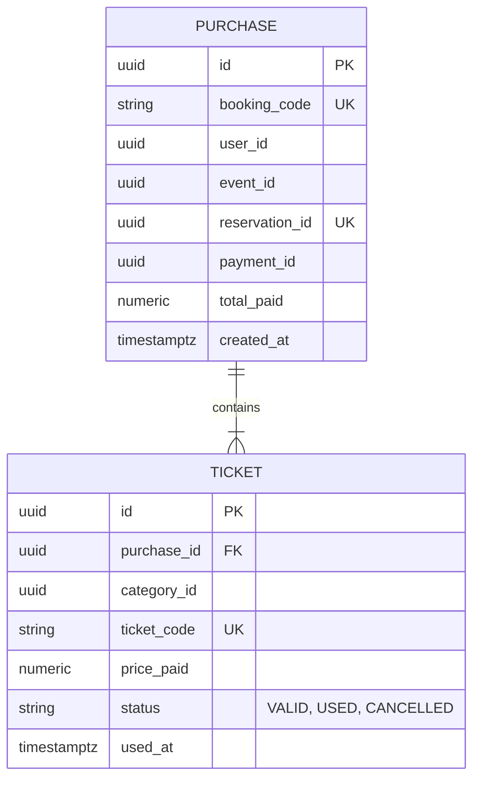
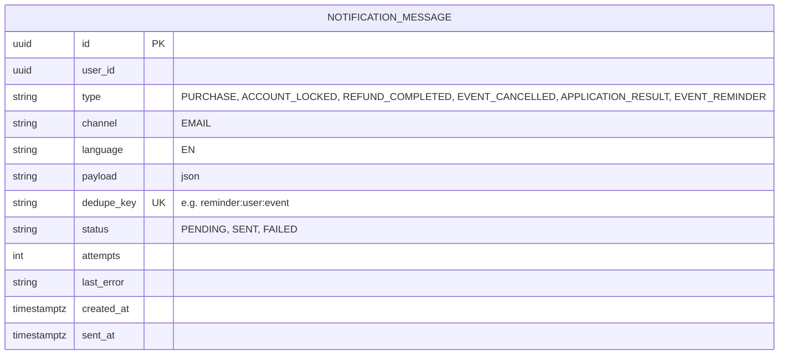
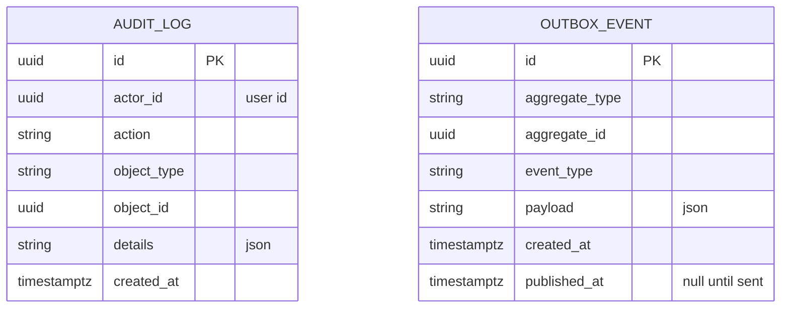

# Data Model (ERD)

> Status: DRAFT (Architecture session 1). Column lists are a first version; types and exact names are finalized when the Flyway migrations are written. Items marked **[PROPOSED]** or **[OPEN]** are not final.

## 1. Rules

- One database schema per module (see `architecture.md`). A module reads and writes only its own tables.
- **No database foreign keys between modules.** A table that points to another module's data stores the plain id (for example `organizer_id`), and the module checks it through the other module's public interface. This keeps modules separable. Foreign keys exist only inside a module.
- Money is stored as `numeric(12,2)` in one currency (the currency is a project setting, not a column, in the MVP).
- All times are stored in UTC (`timestamptz`).
- Ids are UUIDs (decided by Eylül). Prefer time-ordered UUIDs (UUIDv7) so that indexes stay compact; the exact generator is chosen when the first entity is built. Public codes (booking code, ticket code) are separate random values.

## 2. identity

Notes: at most one PENDING application per user (partial unique index). Lockout counters live on the user row (FR-AUTH-1).

## 3. catalog

Notes: unique (`normalized_name`, `city`) on venue (FR-VEN-3). Unique (`event_id`, `name`) on ticket category. The city of an event is its venue's city.

## 4. booking

Notes: `category_stock` is what makes overselling impossible: reserved + sold may never exceed capacity (checked in one atomic update). `user_event_quota` makes the per-user limit (FR-RES-5) enforceable under parallel requests. Decided: `capacity` in `category_stock` is a copy of the catalog capacity, kept in sync by in-process events (category created, capacity changed). The stock update can then check the limit in a single statement, and `catalog` does not depend on `booking`.

## 5. payment

Notes: unique (`payment_id`, `reason`) on refund, so a payment is never refunded twice for the same reason (FR-EVT-15). Amount components are what later refund policies will use (future idea in `requirements.md`).

## 6. ticketing

Notes: unique `reservation_id` on purchase prevents a second purchase for the same reservation (FR-PAY-4). Marking a ticket USED is a single conditional update (`status = 'VALID'`), so two parallel scans give exactly one success (FR-PAY-11).

## 7. notification

Notes: `dedupe_key` stops duplicate messages and duplicate reminders (FR-NTF-5). Messages that keep failing stay with status FAILED and are shown to the admin (US-NTF-3).

## 8. shared

Notes: `outbox_event` is added in Release 3 (see `backlog.md`).

## 9. References between modules (ids only, no foreign keys)

| From | Column | Points to |
|---|---|---|
| catalog.event | organizer_id | identity.app_user |
| catalog.venue | created_by | identity.app_user |
| booking.category_stock | category_id, event_id | catalog.ticket_category, catalog.event |
| booking.reservation | user_id, event_id | identity.app_user, catalog.event |
| booking.reservation_line | category_id | catalog.ticket_category |
| payment.payment | reservation_id, user_id | booking.reservation, identity.app_user |
| ticketing.purchase | reservation_id, payment_id, user_id, event_id | booking.reservation, payment.payment, identity.app_user, catalog.event |
| ticketing.ticket | category_id | catalog.ticket_category |
| notification.notification_message | user_id | identity.app_user |

## 10. Open points

- **[OPEN]** Index design (decided with the first query measurements).
